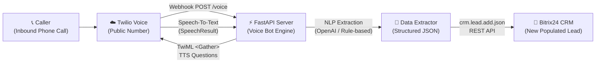

# 📞 Automated Voice-to-Bitrix24 Lead Bot

An end-to-end automated phone bot solution that receives incoming calls, conducts an interactive 3-question qualification survey using Speech-to-Text, extracts structured data (NLP/LLM), and automatically creates a new populated Lead in **Bitrix24 CRM** via its REST API.

---

## 🏗️ Architecture Flow



---

## 🚀 Key Features

1. **Zero-Human Intervention**: Answers phone calls automatically with high-quality Text-to-Speech (TTS).
2. **Interactive 3-Question Dialogue**:
   - **Q1:** Desired service / project interest
   - **Q2:** Company or caller name
   - **Q3:** Preferred contact channel (email / phone)
3. **Structured NLP Extraction**:
   - Uses OpenAI `gpt-4o-mini` (or built-in fallback parser) to sanitize and structure the responses into clean JSON fields.
4. **Seamless Bitrix24 CRM Integration**:
   - Writes Lead Title, Name, Company, Phone number, and full transcript directly into Bitrix24 CRM using the incoming REST webhook.
5. **Background Asynchronous Worker**: Hangs up the call cleanly without holding the caller while pushing data to the CRM.

---

## 📦 Project Structure

```text
voice_to_bitrix24/
│
├── main.py                # FastAPI server & Twilio Voice TwiML state machine
├── bitrix_service.py      # Bitrix24 REST API integration (crm.lead.add)
├── extractor.py           # NLP extraction (OpenAI GPT-4o-mini + fallback)
├── config.py              # Environment configuration loader
├── test_simulation.py     # Automated end-to-end call simulator (no Twilio cost)
├── requirements.txt       # Python dependencies
├── .env.example           # Configuration template
├── .env                   # Active environment variables
├── start.bat              # One-click Windows starter script
└── README.md              # Documentation & setup guide
```

---

## ⚙️ Quick Start & Setup

### Option A: Node.js (Recommended)

```bash
# Navigate to project directory
cd voice_to_bitrix24

# Install dependencies
npm install

# Start the server
npm run dev
# or: npm start
```

### Option B: Python (FastAPI)

```bash
# Navigate to project directory
cd voice_to_bitrix24

# Install dependencies
py -m pip install -r requirements.txt

# Start the server
py main.py
```

### 2. Configure Environment Variables (`.env`)

Copy `.env.example` to `.env` and fill in your details:

```ini
# Bitrix24 Inbound Webhook URL (from Bitrix24 CRM)
BITRIX24_WEBHOOK_URL=https://your-domain.bitrix24.com/rest/1/your_secret_token/crm.lead.add.json

# (Optional) OpenAI API Key for advanced NLP extraction
OPENAI_API_KEY=sk-...

# Server settings
PORT=8000
HOST=0.0.0.0
```

---

## 🔑 How to Get Credentials

### A. Bitrix24 Inbound Webhook
1. Log into your **Bitrix24** account.
2. In the left menu, search for **Developer Resources** (or **Applications** -> **Webhooks**).
3. Click **Add Webhook** -> **Inbound Webhook**.
4. Under **Assign Permissions**, check **CRM (crm)**.
5. Save the webhook and copy the URL.
6. Append `/crm.lead.add.json` to the URL and paste it into `BITRIX24_WEBHOOK_URL` in `.env`.
   * *Example:* `https://b24-xxxx.bitrix24.com/rest/1/abc123xyz456/crm.lead.add.json`

### B. Twilio Phone Number Setup
1. Log into [Twilio Console](https://console.twilio.com/).
2. Buy or select a Voice-enabled phone number.
3. Start your local server and expose it using `ngrok`:
   ```bash
   ngrok http 8000
   ```
4. In Twilio Console:
   - Go to **Phone Numbers** -> **Active Numbers** -> Click your number.
   - Under **Voice Configuration**:
     - **A Call Comes In**: Select `Webhook`.
     - **URL**: `https://your-ngrok-url.ngrok-free.app/voice`
     - **HTTP Method**: `HTTP POST`.
   - Click **Save configuration**.

---

## 🧪 Testing the Bot

### Option 1: Live Phone Call Test
1. Start the server: `py main.py` (or double-click `start.bat`).
2. Run `ngrok http 8000`.
3. Dial your Twilio phone number from your mobile phone.
4. Speak your answers when prompted by the bot.
5. Once the bot thanks you and hangs up, open **Bitrix24 CRM > Leads**. You will see the new lead!

### Option 2: Automated Local Simulator (No Phone Required)
If you want to test the entire pipeline locally without making a phone call:
1. Start the server in one terminal:
   ```bash
   py main.py
   ```
2. In another terminal, run the simulator:
   ```bash
   py test_simulation.py
   ```
This will simulate an entire 3-step voice conversation and create a lead in Bitrix24 instantly.

---

## 🎥 Demonstration / Screencast Guide

For client submission / milestone acceptance:
1. Open Bitrix24 Leads view on the screen.
2. Dial the live test number on speakerphone.
3. Answer the 3 questions:
   - *"I need website design and CRM integration."*
   - *"Acme Technologies."*
   - *"Email me at info@acmetech.com."*
4. Refresh Bitrix24 Leads to show the new Lead with the contact details, service description, and full transcript.

---

## 📄 License
MIT License. Clean and ready for production deployment.
